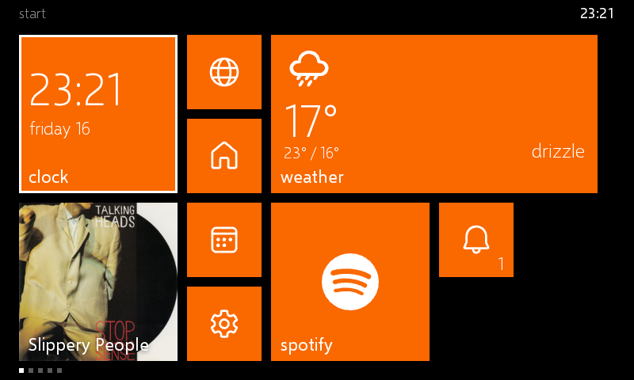

# Metro design spec

A Windows Phone 8.1 Start screen for the Spotify Car Thing, built as a bridgething launcher.


| orange, dark | orange, light |
|---|---|
|  |  |

`design/mock.html` is the source of these images. It is a static 800x480 page that takes
`?accent=<name>&theme=dark|light`. Render a variant with:

```sh
"/Applications/Google Chrome.app/Contents/MacOS/Google Chrome" --headless=new --hide-scrollbars \
  --window-size=800,480 --virtual-time-budget=4000 \
  --screenshot=$PWD/docs/design/mock-orange.png "file://$PWD/docs/design/mock.html?accent=orange"
```

## Concept

The Car Thing panel (800x480, about 4") is the WP7/WP8 WVGA phone screen (480x800) turned sideways, so
Windows Phone pixel specs carry over almost 1:1 in physical size. The difference is distance: a phone is
read at about 30 cm and a dashboard at 60 to 70 cm, so text and targets go up one step.

The home screen is a panorama: a tile grid that scrolls horizontally, split into sections.

| Section | Content | Preset |
|---|---|---|
| start | the tile grid | 1 |
| notifications | the action center: every notification with its time and the phone's actions, clear all | |
| apps | alphabetical list with outlined accent letter jump squares | 2 |
| music | now playing, large, with transport controls | 3 |
| settings | theme picker, brightness, paired phones, restart, edit / reset start | |

Preset 4 is play / pause. The notifications and settings tiles open their sections.



v1 ships the launcher only. A Metro overlay (flat toasts, volume, call, pairing; no blur) is later. Metro already
turns off the system volume bar while it is on screen (`overlays.volume: false`) and draws its own flyout.

## Layout (px)

| Token | Value |
|---|---|
| Viewport | 800 x 480, fixed |
| Status strip | 32 tall, launcher only (an overlay would cover every app's top edge) |
| Grid top / bottom pad | 12 / 24 |
| Grid height | 412 (4 small rows) |
| Gutter | 12 |
| Step (tile + gutter) | 106 |
| Small | 94 x 94 |
| Medium | 200 x 200 |
| Wide | 412 x 200 |
| Large (optional) | 412 x 412 |
| Left margin | 24; the next column peeks at the right edge |

`32 + 12 + 412 + 24 = 480`. Sizes keep WP8 proportions: medium = 2 small + gutter, wide = 2 medium + gutter.

Tile anatomy: label bottom-left inset 12, count badge bottom-right, icon centred. Small tiles have no label.
Corners are square. No gradients, shadows or bevels.

## Type

Selawik (Microsoft, OFL-1.1), the open Segoe UI stand-in, bundled as woff2 in Light, Semilight, Regular,
Semibold. Segoe WP/UI cannot be redistributed or converted to a web font. Fallback: Open Sans.

| Use | Size | Weight |
|---|---|---|
| Tile label | 22 | Regular / Semilight |
| Body, list secondary | 20 | Regular |
| Count badge | 32 | Light |
| Section header (lowercase) | 42 | Light |
| Clock tile | 56 | Light |

Headers and section names are lowercase.

## Color

A theme is a background plus an accent, as on WP. Both are manifest `config` fields, so the user picks them in
the companion app and the launcher reads them with `client.config`; the device's settings page can override them
(kept in `client.store` until the companion changes the same key):

| Key | Choices | Default |
|---|---|---|
| `theme` | `dark`, `light` (enum) | `dark` |
| `accent` | the 20 names below (a pattern-checked string: the companion draws enums as one segmented row, which 20 overflow) | `cyan` |


| Token | Dark | Light |
|---|---|---|
| Background | `#000` | `#fff` |
| Foreground | `#fff` | `#000` (87%) |
| Secondary text | 60% | 60% |
| Disabled | 40% | 30% |
| Text on tiles | `#fff` | `#fff` |

One accent for every app tile, as on WP, from the WP8 set (`design/themes.html` renders this sheet):

| | | | |
|---|---|---|---|
| lime `#A4C400` | green `#60A917` | emerald `#008A00` | teal `#00ABA9` |
| cyan `#1BA1E2` | cobalt `#0050EF` | indigo `#6A00FF` | violet `#AA00FF` |
| pink `#F472D0` | magenta `#D80073` | crimson `#A20025` | red `#E51400` |
| orange `#FA6800` | amber `#F0A30A` | yellow `#E3C800` | brown `#825A2C` |
| olive `#6D8764` | steel `#647687` | mauve `#76608A` | sienna `#A0522D` |

Only the now-playing tile breaks the rule: it takes the album art's dominant colour (saturation-weighted
average, darkened until white text clears 4.5:1), and the accent when there is no art.

## Icons

- App tiles use the app's own icon from `client.webapp.icon`; fallback is the first letter or a glyph.
- System glyphs: Fluent UI System Icons (MIT, `@fluentui/svg-icons`), regular style, 24/28 size, white.
- Brand marks: Simple Icons (CC0 data, trademark rules apply).
- Not shippable: Segoe Fluent Icons, Segoe MDL2 Assets, the Windows logo.

## Tiles

| Tile | Sizes (default first) | Face and live behaviour |
|---|---|---|
| Clock | medium, wide | time and day, flips to the date |
| Now playing | wide, medium | wide: art plus title and artist, the art slides up over the tile; medium: art with the title |
| Notifications | wide, medium, small | latest notification and count, cycles; small: bell with the count, flips to the count |
| Weather (the weather app's tile) | the app's size | glyph and temperature; medium and wide add high/low, wide the condition |
| Settings | small, medium | glyph; opens the settings section |
| Installed apps | first 3 small, the rest medium; any size | icon, a white Metro glyph for built-in apps, or the initial |

The default grid puts three apps and settings in the 2x2 block beside the clock. The user reshapes it with edit mode
on the device or the tile list in the companion; both write the `layout` doc.

### Edit mode

Long press a tile (or settings > edit start). The other tiles sink to `scale(.9)` at half opacity; the selected one
comes forward with arrows to move it. A 52 px app bar along the bottom has a button per size (sizes the tile cannot
take are disabled) and done. Knob: turn to move, press to cycle the size, back or menu to finish.

## Input

| Control | Arrives as | Action |
|---|---|---|
| Knob turn | `wheel`, `deltaX` (one step per event) | move focus, column-major, auto-scroll; on music: volume, or keeps navigating with `music_knob: scroll` |
| Knob press | `keydown` `Enter` (unverified on hardware) | open the focused tile; on music: play / pause |
| Tap | pointer | open; a drag pans the panorama and flings |
| Long press | pointer held 600 ms | edit mode |
| Back | `keydown` `Escape` | back to start; leaves edit mode |
| Presets 1-3 | `keydown` `1`..`3` | jump to start, apps, music |
| Preset 4 | `keydown` `4` | play / pause |
| Hold a preset | no keyup within 500 ms | button guide flyout for 2.5 s (the press still acts) |
| Menu (M) | `keydown` `m`, repeats ignored | start and music, back and forth; five presses is still the system return-home gesture |

Focus: a 3 px foreground ring drawn on a layer above the tile's contents, shown only while driving by knob or keys;
a touch hides it.

Volume: knob steps are 4%, the bar moves at once, and sends coalesce to one absolute level every 40 ms. The flyout is
a 72 px chrome band from the top, 1.5 s.

## Motion

Transforms and opacity only. One element animates at a time where possible.

| Motion | Spec |
|---|---|
| Press | `scale(.975)`, 167 ms, `cubic-bezier(.1,.9,.2,1)` |
| Launch app | turnstile out on visible tiles: `rotateY` 0 to -50deg, 250 ms, 40 ms stagger, then activate |
| Return home | turnstile in: `rotateY` 80deg to 0, 350 ms, 50 ms stagger |
| Live tile flip | `rotateX` 0 to 180deg, 850 ms cubic ease-out; one tile at a time, every 3 to 8 s |
| Now playing peek | art slides `translateY(100%)` to 0 over the tile, 850 ms cubic ease-out, as a live tile turn |
| Album colour | the now playing tile eases its background over 600 ms |
| Edit mode | none: transitions and live tiles stop while the grid re-packs |

Dropped for the GPU: parallax and moving backgrounds, `backdrop-filter`, shadow animation, simultaneous flips.

## Data

| Feature | API |
|---|---|
| Apps | `webapp.list`, `webapp.icon`, `webapp.activate`, `onWebappInstalled/Uninstalled` |
| Clock | `time.onSnapshot`, fallback `Date` |
| Now playing | `player.onSnapshot` / `onDelta` (empty fields keep their last value), `asset.get` with retries |
| Notifications | `notifications.onPosted/onUpdated/onRemoved`, `invokePositive/invokeNegative`; cleared ids remembered |
| Layout (order, sizes, hidden) | `layout` doc, shared with the companion; `tiles` doc lists every tile for it |
| Accent, background | config `theme`, `accent`; device override in `client.store` `theme_override` |
| Knob on music | config enum `music_knob`: `volume` (default) or `scroll` |
| Weather | Open-Meteo via `net.fetch`; location from `geo`, else ipapi.co, else config `weather_location` |
| Device settings | `hardware` (brightness), `bluetooth` (paired phones), `system` (version, restart) |

`just dev-daemon` has no phone, so dev runs against a fake client with sample data (`?mock`).

## Open questions (check on hardware)

- What the knob press sends; Metro treats `Enter` as the press.
- Whether Back does anything beyond `Escape`.

## Sources

Values come from Microsoft's archived Windows Phone 8 design docs (learn.microsoft.com previous-versions), the
Windows Phone Toolkit source (Ms-PL), and WinJS `Animations.js` (MIT).
