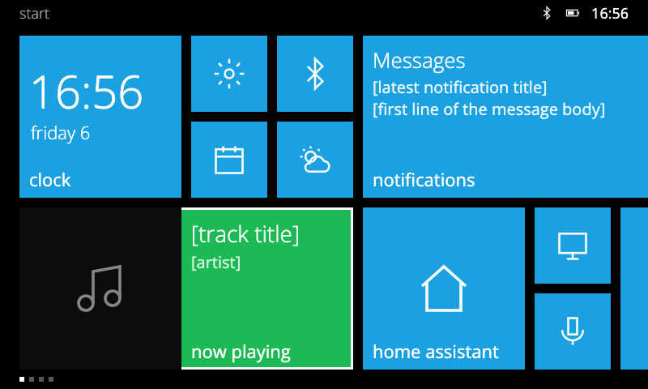
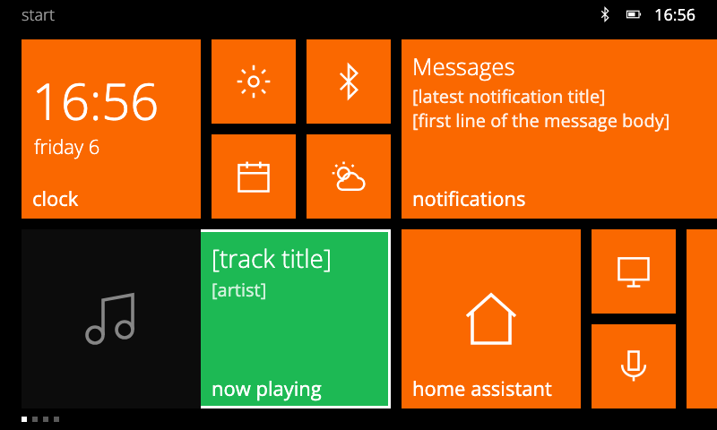
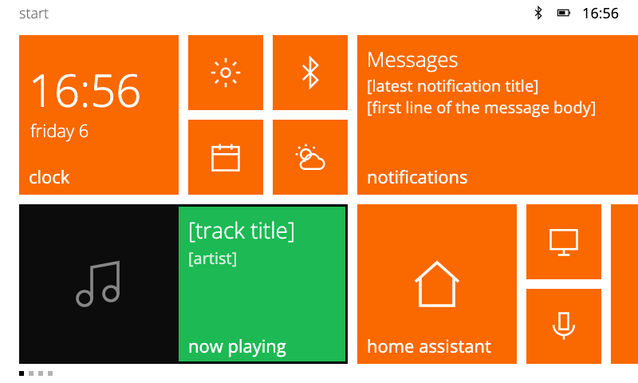
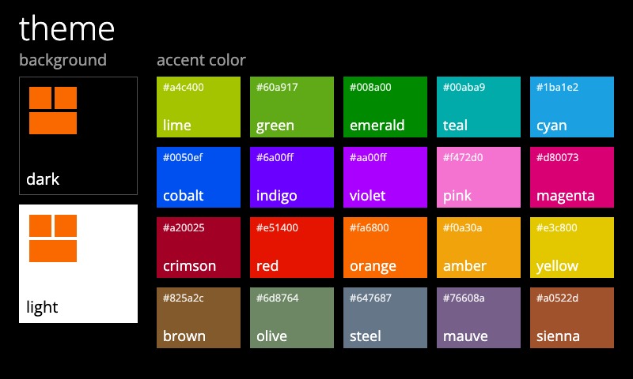

# Metro design spec

A Windows Phone 8.1 Start screen for the Spotify Car Thing, built as a bridgething launcher.



| orange, dark | orange, light |
|---|---|
|  |  |

`design/mock.html` is the source of these images. It is a static 800x480 page that takes
`?accent=<name>&theme=dark|light`. Render a variant with:

```sh
"/Applications/Google Chrome.app/Contents/MacOS/Google Chrome" --headless=new --hide-scrollbars \
  --window-size=800,480 --virtual-time-budget=4000 \
  --screenshot=$PWD/docs/design/mock-orange.png "file://$PWD/docs/design/mock.html?accent=orange"
```

## Concept

The Car Thing panel (800x480, about 4") is the WP7/WP8 WVGA phone screen (480x800) turned sideways, so
Windows Phone pixel specs carry over almost 1:1 in physical size. The difference is distance: a phone is
read at about 30 cm and a dashboard at 60 to 70 cm, so text and targets go up one step.

The home screen is a panorama: a tile grid that scrolls horizontally, split into sections.

| Section | Content | Preset |
|---|---|---|
| start | pinned tiles | 1 |
| apps | alphabetical list with accent letter jump tiles | 2 |
| music | now playing, large, with transport controls | 3 |

Preset 4 is play / pause. A settings section (brightness, bluetooth, system) is planned, not built.

v1 ships the launcher only. A Metro overlay (flat toasts, volume, call, pairing; no blur) is v2.

## Layout (px)

| Token | Value |
|---|---|
| Viewport | 800 x 480, fixed |
| Status strip | 32 tall, launcher only (an overlay would cover every app's top edge) |
| Grid top / bottom pad | 12 / 24 |
| Grid height | 412 (4 small rows) |
| Gutter | 12 |
| Step (tile + gutter) | 106 |
| Small | 94 x 94 |
| Medium | 200 x 200 |
| Wide | 412 x 200 |
| Large (optional) | 412 x 412 |
| Left margin | 24; the next column peeks at the right edge |

`32 + 12 + 412 + 24 = 480`. Sizes keep WP8 proportions: medium = 2 small + gutter, wide = 2 medium + gutter.

Tile anatomy: label bottom-left inset 12, count badge bottom-right, icon centred. Small tiles have no label.
Corners are square. No gradients, shadows or bevels.

## Type

Selawik (Microsoft, OFL-1.1), the open Segoe UI stand-in, bundled as woff2 in Light, Semilight, Regular,
Semibold. Segoe WP/UI cannot be redistributed or converted to a web font. Fallback: Open Sans.

| Use | Size | Weight |
|---|---|---|
| Tile label | 22 | Regular / Semilight |
| Body, list secondary | 20 | Regular |
| Count badge | 32 | Light |
| Section header (lowercase) | 42 | Light |
| Clock tile | 56 | Light |

Headers and section names are lowercase.

## Color

A theme is a background plus an accent, as on WP. Both are manifest `config` enums, so the user picks them in
the companion app and the launcher reads them with `client.config`:

| Key | Choices | Default |
|---|---|---|
| `theme` | `dark`, `light` | `dark` |
| `accent` | the 20 names below | `cyan` |



| Token | Dark | Light |
|---|---|---|
| Background | `#000` | `#fff` |
| Foreground | `#fff` | `#000` (87%) |
| Secondary text | 60% | 60% |
| Disabled | 40% | 30% |
| Text on tiles | `#fff` | `#fff` |

One accent for every app tile, as on WP, from the WP8 set (`design/themes.html` renders this sheet):

| | | | |
|---|---|---|---|
| lime `#A4C400` | green `#60A917` | emerald `#008A00` | teal `#00ABA9` |
| cyan `#1BA1E2` | cobalt `#0050EF` | indigo `#6A00FF` | violet `#AA00FF` |
| pink `#F472D0` | magenta `#D80073` | crimson `#A20025` | red `#E51400` |
| orange `#FA6800` | amber `#F0A30A` | yellow `#E3C800` | brown `#825A2C` |
| olive `#6D8764` | steel `#647687` | mauve `#76608A` | sienna `#A0522D` |

Only the now-playing tile breaks the rule, in Spotify green `#1DB954`.

## Icons

- App tiles use the app's own icon from `client.webapp.icon`; fallback is the first letter or a glyph.
- System glyphs: Fluent UI System Icons (MIT, `@fluentui/svg-icons`), regular style, 24/28 size, white.
- Brand marks: Simple Icons (CC0 data, trademark rules apply).
- Not shippable: Segoe Fluent Icons, Segoe MDL2 Assets, the Windows logo.

## Tiles (v1)

| Tile | Size | Live behaviour |
|---|---|---|
| Clock | medium | time + day, flips to the date |
| Now playing | wide | artwork + title/artist, cycles |
| Notifications | wide | latest notification, count badge |
| Installed apps | first 4 small, the rest medium | icon (or initial), label on medium |

## Input

| Control | Arrives as | Action |
|---|---|---|
| Knob turn | `wheel`, `deltaX` | move focus tile by tile, column-major, auto-scroll; on music: volume up/down |
| Knob press | unknown, verify on device | open focused tile; on music: play / pause |
| Tap | pointer | open tile |
| Back | `keydown` `Escape` | close app list / menu; no-op on start |
| Presets 1-3 | `keydown` `1`..`3` | jump to section, snapping to its start |
| Preset 4 | `keydown` `4` | play / pause |
| M | `keydown` `m` | reserved: system return-home gesture |

Focus: 3 px solid white inset outline (`box-shadow: inset 0 0 0 3px #fff`), no layout shift.

## Motion

Transforms and opacity only. One element animates at a time where possible.

| Motion | Spec |
|---|---|
| Press | `scale(.975)`, 167 ms, `cubic-bezier(.1,.9,.2,1)` |
| Launch app | turnstile out on visible tiles: `rotateY` 0 to -50deg, 250 ms, 40 ms stagger, then activate |
| Return home | turnstile in: `rotateY` 80deg to 0, 350 ms, 50 ms stagger |
| Live tile flip | `rotateX` 0 to 180deg, 850 ms cubic ease-out; one tile at a time, every 3 to 8 s |
| Loading | WP flying dots: 5 squares 4x4, 200 ms stagger, 4.4 s cycle |

Dropped for the GPU: parallax and moving backgrounds, `backdrop-filter`, shadow animation, simultaneous flips.

## Data

| Feature | API |
|---|---|
| Apps | `webapp.list`, `webapp.icon`, `webapp.activate`, `onWebappInstalled/Uninstalled` |
| Clock | `time.onSnapshot`, fallback `Date` |
| Now playing | `player.onSnapshot`, `asset.get` |
| Badges | aggregate `notifications.onPosted/onRemoved` by `app.bundleId` |
| Layout (order, sizes) | `client.store` |
| Accent, background | manifest `config` enums `accent`, `theme` |
| Knob on music | manifest `config` enum `music_knob`: `volume` (default) or `scroll` |

`just dev-daemon` has no phone, so dev runs against a fake client with sample data.

## Open questions (check on hardware)

- What the knob press sends.
- Chromium version: 3D transforms, `@property`, CSS `linear()`.
- Whether Back does anything beyond `Escape`.

## Sources

Values come from Microsoft's archived Windows Phone 8 design docs (learn.microsoft.com previous-versions), the
Windows Phone Toolkit source (Ms-PL), and WinJS `Animations.js` (MIT).
